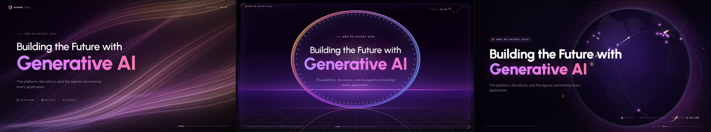
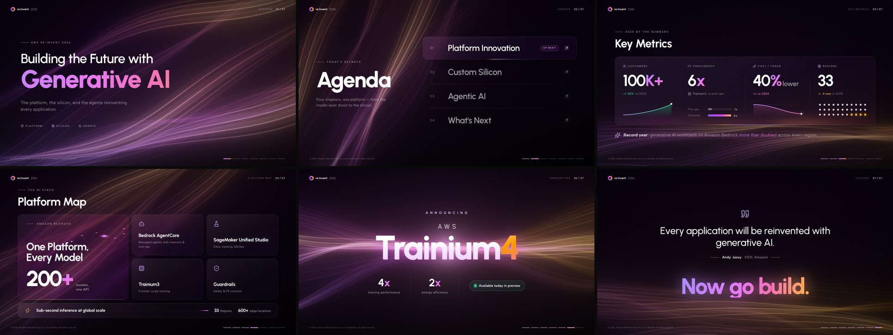
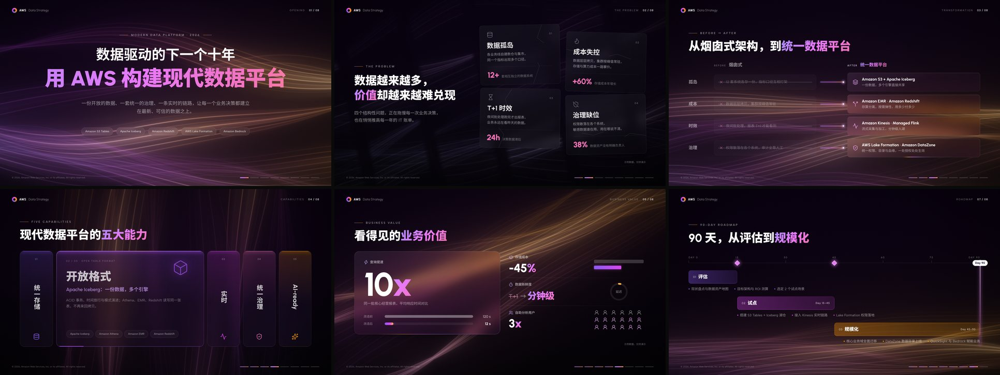
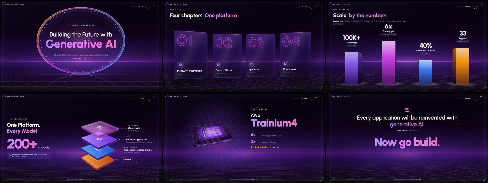
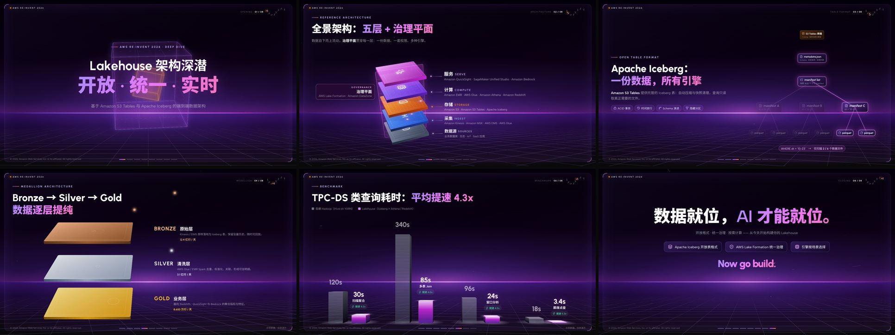
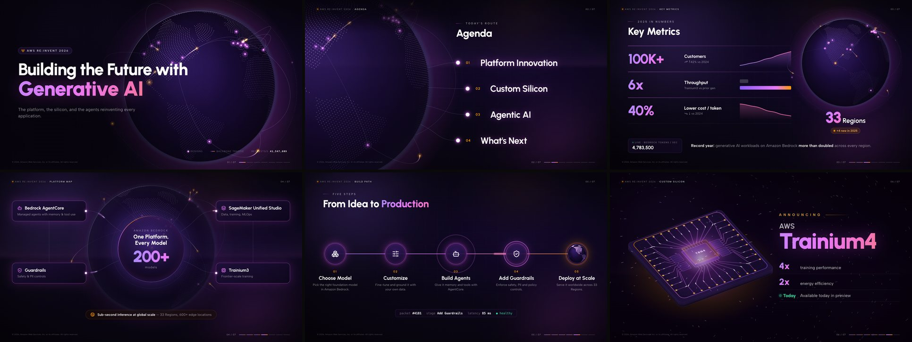
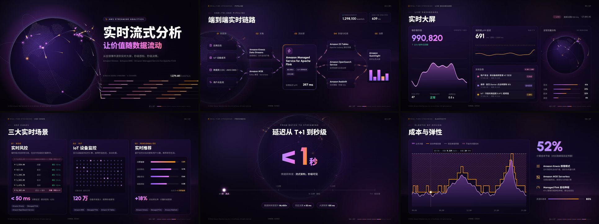
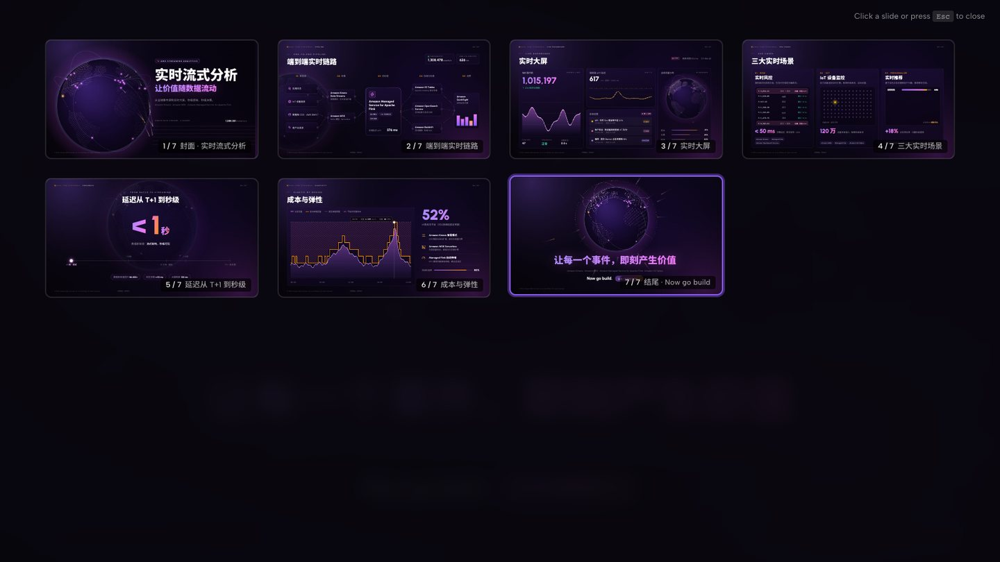
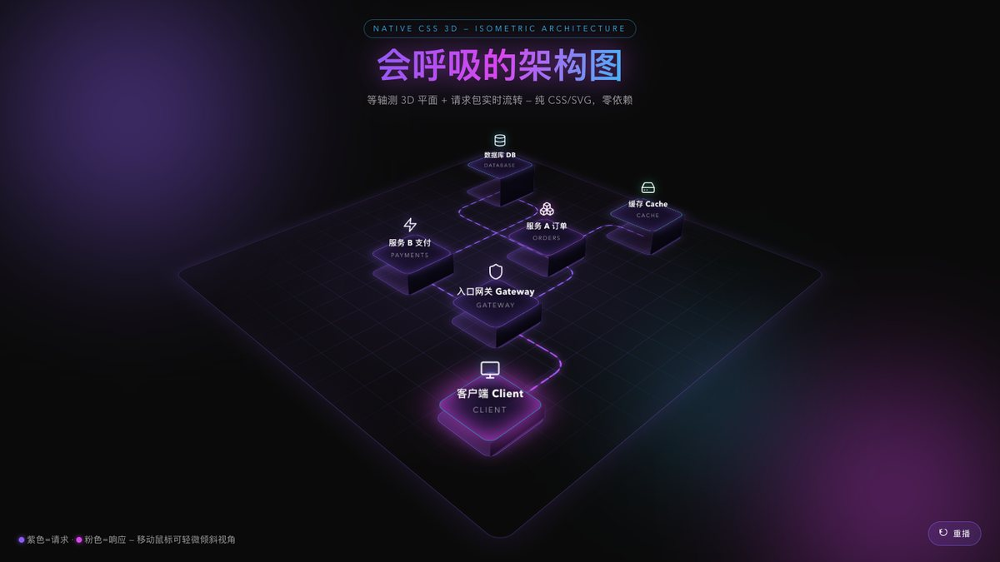
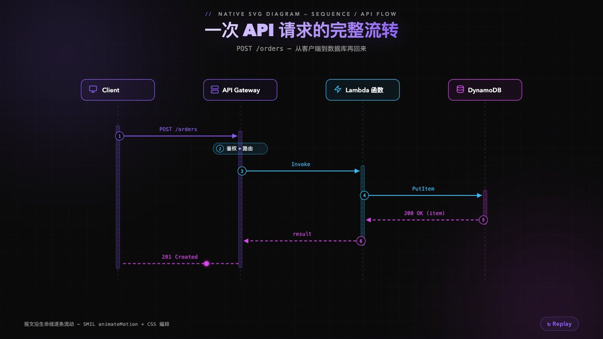

<a href="#english">English</a> | <a href="#中文">中文</a>

---

<a id="english"></a>

# aws-html-slides

An agent skill that builds **keynote-grade HTML presentations in the AWS re:Invent style**, either from scratch or by
converting a PowerPoint deck. The output is one self-contained `index.html` with cinematic motion. It needs no build
step and opens with a double-click.

Based on [@zarazhangrui](https://github.com/zarazhangrui)'s [frontend-slides](https://github.com/zarazhangrui/frontend-slides).



## What This Does

There is **one theme, re:Invent**, in **three visual flavors**. Open the demo decks, pick the flavor you like, and
the skill composes every slide for *your* content in that flavor. The previews are style references, not
fill-in-the-blank templates. An architecture deck gets an architecture, a migration becomes a journey, and a single
number takes over the whole slide.

Each flavor ships **two demo decks**, an English product keynote and a Chinese big-data solution deck, so you can see
how one style adapts to very different content.

## The Three Flavors

### 1 · Aurora: light ribbons and glass

A hand-written WebGL field of silk light ribbons (purple → magenta → AWS orange) flows behind every slide and
re-composes as the story moves. Glass panels, a rotating border light and a cursor spotlight sit on top. Premium and
restrained, so it suits strategy, executive and customer pitches.




<sub>Signature moments: the ribbons converge into a light core before the product name resolves. On the
"before → after" slide, a light seam sweeps across and heals the shattered grey ribbons into full colour.</sub>

### 2 · Spatial: a 3D world with camera flights

The deck is one CSS-3D world over a glowing perspective grid. Changing slides is a camera flight: it pulls back,
banks past the other panels and lands with a settle. This is the most kinetic flavor. Pillars rise from the floor,
layer stacks explode apart, and the camera travels along a migration path. Best for architecture deep-dives, layered
platforms and roadmaps.




<sub>Signature moments: a five-layer exploded architecture with a glass governance plane cutting through it, and a
3D chip that spins in from deep space.</sub>

### 3 · Pulse: a living cloud

A lit dotted globe docks to a new spot on every slide. Region arcs carry light pulses, service graphs pulse with
beams, data packets travel through pipelines, and tickers and charts stream live. This is the most "AWS" flavor,
built for data, streaming, infrastructure and global scale.




<sub>Signature moments: "24 hours" counts down to "< 1 second" before every arc fires at once, and a chip die draws
its circuit traces in.</sub>

## Key Features

- **Three re:Invent flavors, chosen by preview.** Six live demo decks, with no adjectives to decode.
- **Composed, not templated.** Every slide is designed for its content. A design system (brand, EN + CJK typography,
  composition vocabulary, motion language, an anti-"AI slop" list) keeps decks varied and on-brand.
- **Cinematic Stage Engine.**
  - Stacked slides with direction-aware transitions (or a camera flight in Spatial).
  - Intros that replay every time you enter a slide, plus count-ups, split text and per-slide choreography hooks.
  - Keyboard, wheel (trackpad-safe), swipe, and `#N` deep links.
- **Overview mode.** Press `O` or `Esc` for a grid of every slide; click a thumbnail to jump.
- **Print → PDF.** One clean 16:9 page per slide, every slide in its final state.
- **Inline editing + save to file.** Press `E` to edit text in the browser and `Cmd/Ctrl+S` to write the edits back
  into `index.html` (Chrome / Edge).
- **Bilingual.** English and Chinese decks with proper CJK typography (Noto Sans SC, no orphaned characters).
- **Rich content blocks.**
  - Charts (Chart.js) and themed tables.
  - A click-to-zoom lightbox for images.
  - **Native animated SVG diagrams** (flowchart, sequence/UML/ER, network, mind map, isometric 3D architecture)
    described in plain language. AWS icon diagrams via the drawio skill.
- **Built-in self-QA.** After generating, the skill screenshots every slide at two sizes, checks for clipped text and
  console errors, then reviews the shots before handing over.
- **PPT conversion.** Turn a `.pptx` into a re:Invent deck, keeping its text, images and speaker notes.
- **Zero dependencies.** Inline CSS/JS and hand-written WebGL/canvas. The only network loads are Google Fonts and
  Lucide icons.

### Overview mode



### Native SVG diagrams

<table>
<tr>
<td width="50%"><br><sub><b>Isometric 3D architecture</b>: layered nodes with request/response packets.</sub></td>
<td width="50%"><br><sub><b>Sequence / API flow</b>: messages animate down the lifelines in order.</sub></td>
</tr>
</table>

## Installation

### Option 1: Clone and copy the skill folder

```bash
git clone https://github.com/lanceli93/aws-html-slides.git
cp -r aws-html-slides/aws-html-slides ~/.claude/skills/aws-html-slides
```

### Option 2: Clone and symlink (easy to update)

```bash
git clone https://github.com/lanceli93/aws-html-slides.git ~/aws-html-slides
ln -s ~/aws-html-slides/aws-html-slides ~/.claude/skills/aws-html-slides
```

To update later, run `git pull` in the cloned repo.

## Usage

```
/aws-html-slides
```

### Path 1: Create a new presentation

```
Step 1  →  Setup (language, mode, editing, page count)
Step 2  →  Topic
Step 3  →  Open the demo decks and pick a flavor: 1 Aurora · 2 Spatial · 3 Pulse
Step 4  →  Fill in content.md (the skill reviews it and plans each slide's composition)
Step 5  →  Generate HTML → automatic screenshot self-QA → open in browser
```

```
/aws-html-slides
> "I want to create a customer pitch about migrating Hadoop to a Lakehouse on AWS"
```

### Path 2: Convert a PowerPoint

```
Step 1  →  Setup (language, mode)
Step 2  →  Provide .pptx file path
Step 3  →  Pick a flavor → auto-extract + re-compose + self-QA (done)
```

## Output

```
my-presentation/
├── index.html        # Self-contained presentation (all CSS/JS inline)
└── assets/           # Media files (auto-copied)
```

| Action | How |
|---|---|
| Next / previous slide | → / ← · Space · wheel · swipe |
| Overview | `O` or `Esc` |
| Jump to slide N | `#N` in the URL |
| Edit text (if enabled) | `E`, then `Esc` to save, `Cmd/Ctrl+S` to write to the file |
| Export to PDF | Print → Save as PDF |
| Share | Zip the folder; the recipient unzips it and opens `index.html` |

## Repository Layout

| Path | What |
|---|---|
| `aws-html-slides/SKILL.md` | The skill workflow |
| `aws-html-slides/design-system.md` | re:Invent brand, typography, composition and motion rules, QA checklist |
| `aws-html-slides/engine/` | Stage Engine (`stage-engine.{css,js}`), the opt-in inline editor, API reference, example deck |
| `aws-html-slides/flavors/{aurora,spatial,pulse}/` | Flavor kits: motif + components (`kit.css`, `kit.js`) and a generator guide |
| `aws-html-slides/preview/` | The six demo decks |
| `aws-html-slides/scripts/` | content.md template generator, PPT extractor, screenshot QA |
| `demos/` | Native SVG diagram demos and extra 3D/motion technique demos (see `effects-reference.md`) |

## Requirements

- An AI IDE or agent that supports skills (e.g. [Claude Code](https://claude.ai/claude-code)).
- [uv](https://docs.astral.sh/uv/) for the helper scripts. PPT conversion uses `python-pptx`; the self-QA screenshots
  use Playwright with your installed Google Chrome. Both are fetched automatically by `uv run --with …`.
- Optional, only for AWS-icon architecture diagrams (`type: aws`): the
  [draw.io desktop](https://github.com/jgraph/drawio-desktop/releases) CLI (`brew install --cask drawio`) and the
  [drawio-skill](https://github.com/Agents365-ai/drawio-skill). Every other diagram type is drawn natively.

## License

MIT. See [LICENSE](LICENSE) for details.

---

<a id="中文"></a>

# aws-html-slides

这是一个 Agent 技能，用来生成 **AWS re:Invent 风格、发布会级别的 HTML 演示文稿**。可以从零开始做，也可以把
PowerPoint 转换过来。产出是一个自包含的 `index.html`，带电影感的动效，不需要构建，双击就能打开。

基于 [@zarazhangrui](https://github.com/zarazhangrui) 的 [frontend-slides](https://github.com/zarazhangrui/frontend-slides) 项目。


## 这是什么

技能只有 **re:Invent 一个主题**，分 **三种视觉风格**。先打开 demo 看效果，选一种你喜欢的，技能再按这个风格，针对
**你的内容**设计每一页。demo 只是风格参考，不是填空模板：讲架构就画出架构，讲迁移就做成一段旅程，只有一个关键
数字就让它占满整页。

每种风格都配了 **两套 demo**：一套英文产品发布会，一套中文大数据方案。同一种风格换了内容会变成什么样，一看
就清楚。

## 三种风格

### 1 · 流光 Aurora：光带与玻璃

背景是一片手写 WebGL 的丝绸光带，颜色从紫色过渡到品红，再到 AWS 橙，贯穿全场，并随叙事重新构图。前景是玻璃
面板、流光边框和跟随鼠标的聚光。整体克制、高级，适合战略、管理层汇报和客户提案。


<sub>高光时刻：新品揭晓前，光带先汇聚成一个光核。"转型前后"那一页，一道光缝从左扫到右，把碎裂的灰色光带修复成
完整的彩色。</sub>

### 2 · 空间 Spatial：3D 世界与镜头飞行

整套演示放在一个 CSS 3D 世界里，下面是发光的透视网格地面。翻页就是一次镜头飞行：先拉远，从其他页面旁边转弯
掠过，再回弹落定。这是动感最强的风格：指标柱从地面升起，分层架构爆炸展开，镜头沿着迁移路径一站站前进。最适合
讲架构细节、分层平台和路线图。


<sub>高光时刻：五层架构爆炸图，中间有一面玻璃治理平面纵向贯穿所有层；还有一颗从远处旋转飞入的 3D 芯片。</sub>

### 3 · 脉动 Pulse：活的云

一颗发光的点阵地球贯穿全场，每一页都停在不同的位置。区域之间的光弧上跑着光脉冲，服务节点之间光束涌动，数据包
沿流水线流动，实时计数和曲线不停滚动。这是最有"AWS 味"的风格，适合讲数据、流式处理、基础设施和全球规模。


<sub>高光时刻："24 小时"一路倒数到"< 1 秒"，随后所有光弧同时点亮；芯片的电路走线一笔笔画出来。</sub>

## 核心特性

- **三种 re:Invent 风格，看 demo 选**：6 套可以直接打开的演示，不用靠形容词去猜效果。
- **按内容自由构图，不套模板**：每一页都根据内容来设计。另有一套设计系统兜底，保证每次生成既有变化又符合品牌，
  内容包括：品牌规范、中英文排版、构图思路、动效原则，以及一份"拒绝 AI 味"的禁用清单。
- **电影感舞台引擎**：
  - 页面叠放，切换时有带方向感的转场（空间风格是镜头飞行）
  - 每次进入页面，进场动画都会重播
  - 支持数字滚动、文字拆分动画，每一页还能单独编排动画
  - 可以用键盘、滚轮（触控板惯性不会误翻）、手势滑动翻页，也能用 `#N` 直接跳到第 N 页
- **概览模式**：按 `O` 或 `Esc` 打开全部页面的缩略图，点任意一页就能跳过去。
- **打印成 PDF**：每页导出为一张 16:9 的干净页面，所有动画都显示最终完成的状态。
- **浏览器内编辑，可存回文件**：按 `E` 直接在浏览器里改文字，按 `Cmd/Ctrl+S` 把修改写回 `index.html`
  （仅 Chrome / Edge）。
- **中英双语**：中文排版专门处理过，使用 Noto Sans SC，不会出现一行只剩一个字的情况。
- **丰富的内容块**：
  - 图表（Chart.js）和套用主题配色的表格
  - 点击图片可以放大查看
  - 用自然语言描述，就能生成**原生动画 SVG 图**：流程图、时序/UML/ER 图、网络拓扑、思维导图、等轴测 3D 架构图；
    带 AWS 官方图标的架构图通过 drawio skill 生成
- **生成后自动自检**：每页在两种尺寸下截图，检查有没有文字被截断、控制台有没有报错，再逐张看图评审，确认没问题
  才交付。
- **PPT 转换**：把 `.pptx` 重新排成 re:Invent 风格，文字、图片和演讲者备注都保留。
- **零依赖**：CSS/JS 全部内联，WebGL 和 Canvas 都是手写的。只有 Google Fonts 和 Lucide 图标需要联网加载。

### 概览模式


### 原生 SVG 图

<table>
<tr>
<td width="50%"><br><sub><b>等轴测 3D 架构</b>：分层节点，请求包和响应包来回流动。</sub></td>
<td width="50%"><br><sub><b>时序 / API 流程</b>：报文沿生命线自上而下逐条流动。</sub></td>
</tr>
</table>

## 安装

### 方式一：克隆后复制技能文件夹

```bash
git clone https://github.com/lanceli93/aws-html-slides.git
cp -r aws-html-slides/aws-html-slides ~/.claude/skills/aws-html-slides
```

### 方式二：克隆后创建符号链接（便于更新）

```bash
git clone https://github.com/lanceli93/aws-html-slides.git ~/aws-html-slides
ln -s ~/aws-html-slides/aws-html-slides ~/.claude/skills/aws-html-slides
```

以后要更新，在克隆下来的仓库里执行 `git pull` 就行。

## 使用方法

```
/aws-html-slides
```

### 路径一：新建演示文稿

```
第 1 步  →  基本设置（语言、模式、是否可编辑、页数）
第 2 步  →  主题
第 3 步  →  打开 demo，选一种风格：1 流光 · 2 空间 · 3 脉动
第 4 步  →  填写 content.md（技能会审一遍内容，并规划每一页的构图）
第 5 步  →  生成 HTML → 自动截图自检 → 在浏览器中打开
```

```
/aws-html-slides
> "帮我做一份客户方案：把自建 Hadoop 迁移到 AWS 上的 Lakehouse"
```

### 路径二：转换 PowerPoint

```
第 1 步  →  基本设置（语言、模式）
第 2 步  →  提供 .pptx 文件路径
第 3 步  →  选风格 → 自动提取、重新构图、自检，完成
```

## 输出结构

```
my-presentation/
├── index.html        # 自包含的演示文稿（CSS/JS 全部内联）
└── assets/           # 素材文件（自动复制过来）
```

| 操作 | 方式 |
|---|---|
| 下一页 / 上一页 | → / ← · 空格 · 滚轮 · 手势滑动 |
| 概览 | `O` 或 `Esc` |
| 跳到第 N 页 | 在网址后加 `#N` |
| 编辑文字（如已开启） | 按 `E` 编辑，按 `Esc` 保存，按 `Cmd/Ctrl+S` 写回文件 |
| 导出 PDF | 打印 → 存储为 PDF |
| 分享 | 把整个文件夹打包成 zip，对方解压后打开 `index.html` |

## 仓库结构

| 路径 | 内容 |
|---|---|
| `aws-html-slides/SKILL.md` | 技能工作流 |
| `aws-html-slides/design-system.md` | re:Invent 品牌、排版、构图与动效规范，QA 检查清单 |
| `aws-html-slides/engine/` | 舞台引擎（`stage-engine.{css,js}`）、可选的浏览器内编辑器、API 文档、示例 deck |
| `aws-html-slides/flavors/{aurora,spatial,pulse}/` | 三种风格的工具包：背景母题和组件（`kit.css`、`kit.js`），以及给生成用的说明 |
| `aws-html-slides/preview/` | 6 套 demo |
| `aws-html-slides/scripts/` | content.md 模板生成、PPT 提取、截图 QA |
| `demos/` | 原生 SVG 图 demo，以及额外的 3D/动效技术 demo（见 `effects-reference.md`） |

## 环境要求

- 支持技能（skill）的 AI IDE 或 Agent，例如 [Claude Code](https://claude.ai/claude-code)。
- [uv](https://docs.astral.sh/uv/)，用来运行辅助脚本：PPT 转换用 `python-pptx`，自检截图用 Playwright，调用本机
  已安装的 Google Chrome。依赖都会通过 `uv run --with …` 自动拉取。
- 可选，仅在需要带 AWS 官方图标的架构图（`type: aws`）时：[draw.io 桌面版](https://github.com/jgraph/drawio-desktop/releases)
  的命令行（`brew install --cask drawio`）和 [drawio-skill](https://github.com/Agents365-ai/drawio-skill)。其他类型的
  图都直接原生绘制，不需要额外安装。

## 许可证

MIT，详见 [LICENSE](LICENSE)。
